<p align="center">
  <picture><source media="(max-width: 767px)" srcset="assets/readme/banner-m.png"></picture>
</p>

<p align="center">
  
  
  
</p>

A First Notice of Loss (FNOL) is the first report of an insurance claim, and it rarely arrives in a tidy format. This agent reads one, pulls out the fields an insurer needs, lists what is missing, and routes the claim to the right queue with a plain reason such as *"Routed to Fast-track because estimated damage (₹12,500.00) is below the ₹25,000 threshold and no other flags were triggered."*

The split of work is the point. An LLM does the reading, because FNOL wording and layout vary. Plain Python makes the routing decision, so the same claim always gets the same route, every decision traces back to one rule, and the agent keeps working when the LLM is down.

<p align="center">
  <picture><source media="(max-width: 767px)" srcset="assets/readme/proof-m.png"></picture>
</p>

<p align="center">
  <picture><source media="(max-width: 767px)" srcset="assets/readme/glance-m.png"></picture>
</p>

## Quick start

```bash
git clone https://github.com/JustKamlesH21/Insurance_Agent.git
cd Insurance_Agent
python -m venv .venv && source .venv/bin/activate      # Windows: .venv\Scripts\activate
pip install -r requirements.txt
cp .env.example .env                                   # add OLLAMA_API_KEY (optional)
streamlit run app.py
```

Upload any file from `sample_fnols/` (or your own `.txt` or `.pdf`) and click **Process Claim**. From the command line:

```bash
python pipeline.py sample_fnols/claim1_fasttrack.txt
```

Without an `OLLAMA_API_KEY`, or if the API call fails, extraction falls back to regex parsing and the pipeline still returns a full result.

## How it works

<p align="center">
  <picture><source media="(max-width: 767px)" srcset="assets/readme/how-it-works-m.png"></picture>
</p>

**Extract.** `extractor.py` sends the document to `gpt-oss:120b-cloud` on Ollama Cloud (60 s timeout) and validates the reply against the Pydantic schema in `schema.py`. On any failure it uses regex instead. The result records which method ran.

**Check.** `router.py` lists any of the 16 mandatory fields that are empty (policy number, policyholder, dates, location, description, claimant, damage estimate and so on; the full list is `MANDATORY_FIELDS` in `schema.py`).

**Route.** The first matching rule wins:

| # | Route | When |
|---|---|---|
| 1 | Manual Review | any mandatory field is missing |
| 2 | Investigation Flag | the description contains "fraud", "inconsistent" or "staged" (any case) |
| 3 | Specialist Queue | the claim type is "injury" |
| 4 | Fast-track | estimated damage is below ₹25,000 |
| 5 | Standard Review | everything else |

**Log.** Every claim is written to `claims_log.xlsx`, one row per policy number: a new policy adds a row, the same policy again updates it. A locked Excel file never stops the agent; the JSON result is returned regardless.

```json
{
  "extractedFields": {},
  "missingFields": [],
  "recommendedRoute": "",
  "reasoning": ""
}
```

## Architecture

<p align="center">
  <picture><source media="(max-width: 767px)" srcset="assets/readme/architecture-m.png"></picture>
</p>

## Sample claims

`sample_fnols/` has 10 documents, one or more per route, including the edge cases: damage of exactly ₹25,000 (Standard Review), just under it (Fast-track), injury plus fraud wording (Investigation wins), and upper-case keywords. With the LLM switched off, all 10 route as their file names say. To check them yourself:

```bash
python -c "import glob, pipeline; [print(f, '->', pipeline.run_fnol_agent_from_file(f)['recommendedRoute']) for f in sorted(glob.glob('sample_fnols/*.txt'))]"
```

Each run also updates `claims_log.xlsx`. [GUIDE.md](GUIDE.md) walks through every file, the routing priority and the expected result for each sample.

## Project layout

| File | What it does |
|---|---|
| `schema.py` | Pydantic schema and the list of mandatory fields |
| `llm_client.py` | Ollama Cloud call with timeout and failure handling |
| `extractor.py` | LLM extraction with the regex fallback |
| `router.py` | Missing-field check and the routing rules |
| `excel_logger.py` | Upserts each claim into `claims_log.xlsx` |
| `pipeline.py` | Runs the whole flow; CLI entry point |
| `app.py` | Streamlit demo |

## License

No license file has been added yet, so default copyright applies.

<p align="center">
  <a href="https://github.com/JustKamlesH21"><picture><source media="(max-width: 767px)" srcset="assets/readme/footer-m.png"></picture></a>
</p>
